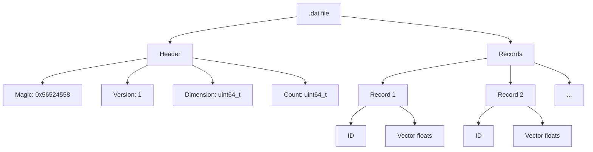
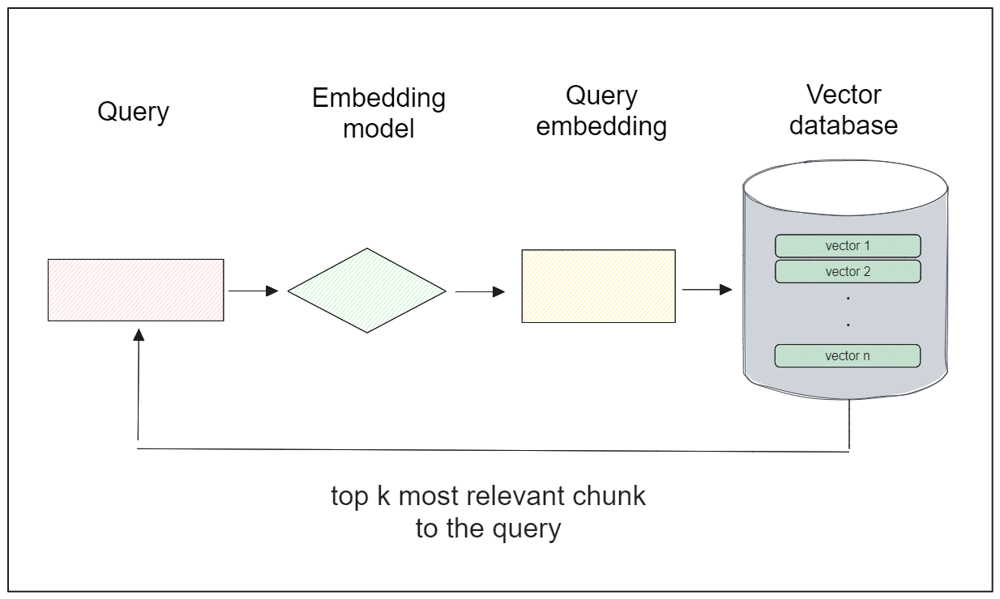
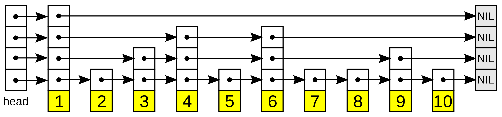
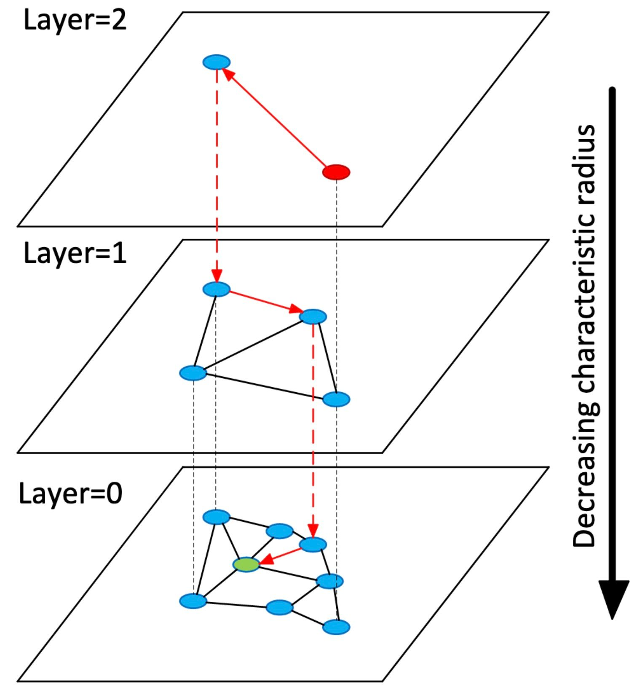

# VectoRex

A from-scratch, high-performance vector similarity search engine in C++ to understand the wokring of the vectordb and systems.

## `.dat` file Architecture

# HNSW(Hierarichal Navigavble Small World)
there are four types of vector search indexes: hash-based, tree-based, cluster-based, and graph-based.

HNSW fits firmly into the latter category: the **graph** index algorithm.

It combines two core concepts - the `probability skip list` and `Navigable Small World (NSW) graphs`.

### Probabilistic Skip List
A probability skip list is a multi-level linked list where the upper levels maintain long connections. As we move down the layers, the connections become shorter and shorter, with the bottom layer being the "original" linked list containing all of the elements. The image below illustrates this probability skip list structure:

- A **Skip List** improves search in a linked list by adding multiple layers of pointers.
- **Time Complexity:** `O(log n)` average search, insertion, and deletion.
- **Space Complexity:** `O(n)` expected space.
- **Trade-off:** Uses extra memory and has slightly more overhead than a normal linked list.
- **Purpose:** Faster searching without requiring a balanced tree.

### Navigable Small World (NSW)
NSW is a graph-based algorithm that finds approximate nearest neighbors in a dataset. The general idea here is first to imagine many nodes in a network. Each node will have short-, medium-, and long-range connections to other nodes. When performing a vector search, we'll begin at some pre-defined entry point. From there, we'll evaluate connections to other nodes and jump to the one closest to the one we hope to find. This process repeats until we've found our nearest neighbor.

## HNSW (Hierarchical Navigable Small Worlds)
HNSW extends NSW by borrowing from the concept of skip lists. Like the skip list, HNSW maintains multiple layers (hence the term Hierarchical Navigable Small World), only of NSWs instead of linked lists. The uppermost layer of an HNSW graph has few nodes and the longest links, while the bottommost layer has all nodes and the shortest links.

https://zilliz.com/learn/hierarchical-navigable-small-worlds-HNSW
